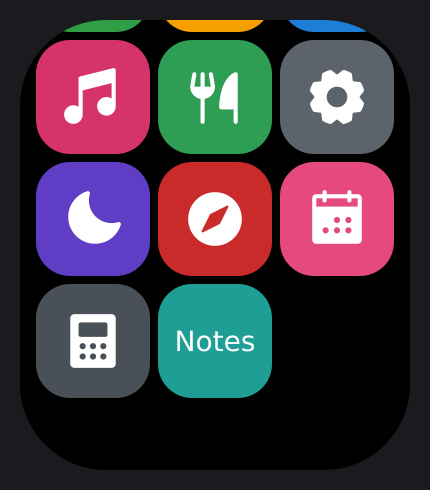
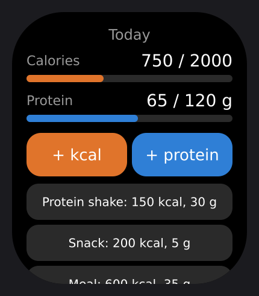
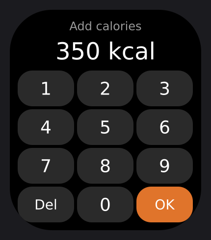
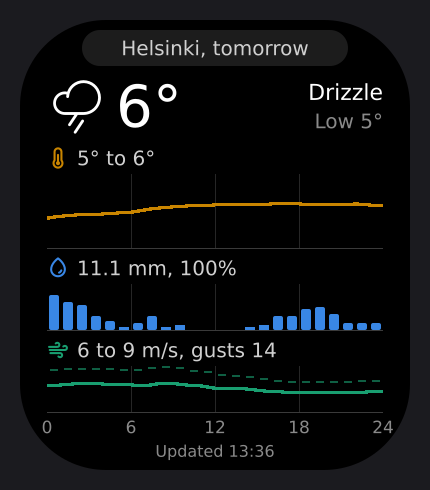

# Zepp OS launcher watch face and apps for the Amazfit Cheetah (Square)

Sideloaded straight from this repo; nothing here goes through the Zepp app store.

## Which watch this is for

Everything here is made for one watch: the **Amazfit Cheetah (Square)**, the model with
the square display. Not the Cheetah Pro and not the round Cheetah.

| | |
| --- | --- |
| Display | Square, 390 × 450 pixels, with rounded corners |
| System | Zepp OS 3.5 (API level 3.6) |
| Install | Sideloaded by QR code through the Zepp app's Developer Mode |

Every screen is laid out by hand for that 390 × 450 display and its rounded corners, and
that watch is the only one anything here has run on. The build also produces packages
for other Zepp OS watches with a 390-pixel-wide square screen, but those are untested,
and nothing here is built for round screens.

This is a personal project, not affiliated with Zepp or Amazfit.

| Launcher Face | Launcher app | More than nine tiles | Nutrition | |
| --- | --- | --- | --- | --- |
|  |  |  |  |  |

| Weather | Tomorrow |
| --- | --- |
|  |  |

- **Launcher Face** is a thin-line watch face: the time as outlined hours over minutes,
  weekday and date, battery ring, steps and heart rate. The button in the bottom right
  corner opens the Launcher.
- **Launcher** is a grid of app tiles, three to a row. Nine fit a screen; more scroll.
  You choose the tiles by editing a short text list in the Zepp app on the phone.
- **Nutrition** logs calories and protein from the wrist: a keypad for exact amounts,
  one-tap buttons for things you eat often, daily goals, and undo.
- **Weather** shows the whole day on one screen: the conditions now, then temperature,
  rain or snow, and wind hour by hour. The place and units are set on the phone.

The pictures are drawn by `npm run screens` from the real code running against a mock
watch. They show layout, not the watch's exact rendering.

> **Status:** everything builds and passes the tests against the mock in `test/support`.
> On a real Cheetah (Square), installing by QR code, the Launcher app and the Nutrition
> app have been confirmed. The current watch face design and the Weather app have not
> been on a watch yet.
> See [What is and is not verified](#what-is-and-is-not-verified).

## Install on the watch

You need Node 22.15 or newer, the Zepp app paired with the watch, and a Zepp account.
The watch should be on current firmware (Zepp OS API level 3.6).

Run everything from the repo folder. Running `npx zeus` anywhere else silently uses a
different copy of the CLI.

```sh
npm install
npx zeus login --no-browser   # once
npm run qr:watchface          # builds, then prints a QR code
npm run qr:launcher
npm run qr:nutrition
npm run qr:weather
```

1. **Developer mode.** In the Zepp app: Profile → Settings → About, tap the Zepp icon
   seven times.
2. **Log in.** `zeus login --no-browser` prints a login URL. Open it on any device, sign
   in, and paste the final `http://localhost:…` address from the browser's address bar
   back into the terminal. (That page fails to load; only its address is needed.)
3. **Scan.** Each `npm run qr:…` asks which device to build for, then shows a QR code. In
   the Zepp app: Profile → your watch → Developer Mode → Scan.
4. **Pick the watch face.** Long-press the current watch face on the watch and choose
   Launcher Face.

The Developer Mode page also shows the watch's API level (Device information) and app
logs, which is the first place to look if something misbehaves.

## Choosing the tiles

Open the Launcher's settings in the Zepp app and edit the list, one line per tile,
three to a row, left to right and top to bottom. The watch picks it up the next time
the Launcher opens with the phone nearby, and keeps its own copy after that.

```
Workout = workout
Heart rate = hr
Torch = screen:FlashLightScreen @torch
Nutrition = app:68232:page/index @food
Calc = app:1234:page/index
sleep
```

| Target | Opens |
| --- | --- |
| `timer` | A built-in app, by name. The label can be left out. |
| `app:68232:page/index` | A mini app, by its app id and entry page. |
| `name:Calculator:page/index` | A mini app, found by its English name. |
| `screen:FlashLightScreen` | A built-in screen, by its internal screen name. |

- **Icons.** Built-in apps get their icon automatically. Any other tile shows its label
  as text unless you add `@icon`. The same syntax swaps a built-in app's icon.
- **Colours.** Icon tiles come ready coloured. For a text tile, `#rrggbb` at the end of
  the line sets its colour.
- Lines starting with `#` are comments. Up to 60 tiles; more than nine scroll.
- The settings page previews the result and points out lines it could not read. A bad
  line is skipped; the rest still load.

Built-in app names: `activity`, `hr`, `workout`, `history`, `status`, `weather`, `alarm`,
`timer`, `stopwatch`, `pomodoro`, `worldclock`, `calendar`, `todo`, `music`, `camera`,
`findphone`, `phone`, `settings`, `sleep`, `spo2`, `stress`, `breathe`, `pai`,
`readiness`, `measure`, `cycle`, `body`, `thermometer`, `compass`, `barometer`,
`sunmoon`, `coach`, `voicememo`, `alexa`, `cards`, `membership`. Not every watch has
every app.

Icon names: every built-in app name except `pai` and `membership`, plus `app`, `food`,
`torch`, `star`, `heart`, `calculator`, `note`, `map`, `route`, `game`, `book`, `wallet`,
`home`, `bolt`, `bike`, `swim`, `yoga`, `mountain`, `scale`, `pill`, `coffee`, `cart`,
`key`, `lock`, `bell`, `photo`, `wifi`, `bluetooth`, `qr`, `cloud`, `chart`, `search`,
`headphones`, `playlist`, `radio`, `mail`, `chat`, `contacts`, `translate`, `news`,
`plane`, `car`, `dog`, `leaf`, `fire`, `sun`, `watch`, `speed`, `id`, `medal`, `trophy`.

To add an icon, add a line to `shared/icons.js` naming any of the 1,500
[Phosphor icons](https://phosphoricons.com) and a colour, then run `npm run icons` and
reinstall the Launcher.

For a mini app you need its app id and the path of its first page, both found in that
app's `app.json` if it is open source. Zepp OS offers no way to list installed apps.

## Nutrition

On the watch: **+ kcal** and **+ protein** open a keypad; the buttons underneath add a
preset in one tap; **Undo last** removes the most recent addition of the day.

In the Zepp app, the Nutrition settings page holds the history (synced whenever the
tracker opens with the phone nearby), the daily goals, and the quick-add buttons, one
per line as `Label = kcal, protein`, up to six.

**This does not feed Zepp's own Food Log.** Zepp OS has no API for a mini app to write
food, calorie-intake or any other health data into the Zepp app, so the totals live in
this app: on the watch (last 30 days) and in its settings page on the phone (last 180).

## Weather

One screen, read left to right as midnight to midnight at the chosen place:

- **Top:** the place and day, the conditions now, the temperature and what it feels like.
- **Temperature:** a line, with the day's low and high beside the thermometer.
- **Rain and snow:** a bar per hour, blue for rain and white for snow, with the day's
  total and the highest chance of any hour.
- **Wind:** a line for the speed with a dash above it for each hour's gusts, and the
  direction it is blowing from right now.
- The vertical line and the white dot are now; hours already gone are drawn darker.
- **Tap the place name** to see tomorrow, and again to come back.
- The last line says when the forecast was fetched.

**Setting the place.** In the Zepp app, open the Weather app's settings, type a town or
city into the search box and confirm. The best match is used straight away; if it is
the wrong Springfield, tap the right one in the list underneath. Temperature (°C with
mm, or °F with inches) and wind speed (m/s, km/h, mph, knots) are on the same page.

**Where the data comes from.** The watch has no internet of its own, so each time the
app opens it asks the phone, and the phone asks [Open-Meteo](https://open-meteo.com),
a free forecast service that needs no account or key. The watch keeps the last
forecast: it appears at once the next time, and still covers the rest of today and
tomorrow if the phone is out of reach. Weather data by Open-Meteo.com, CC BY 4.0.

**In the Launcher.** Add this line to the tile list (it can replace the built-in
`Weather = weather`):

```
Weather = app:68234:page/index @weather
```

## Development

```sh
npm test          # unit tests, plus the real code run against a mock watch
npm run icons     # regenerate tile icons, watch face artwork and app icons
npm run screens   # redraw docs/*.png and the watch face's preview image
npm run build     # all four -> apps/*/dist/*.zab (no login needed)
```

```
shared/            config parser, tile layout, icon table, tile drawing
apps/watchface/    the watch face; its positions are in watchface/layout.js
apps/launcher/     page, side service (runs in the Zepp app), settings page
apps/nutrition/    two pages, side service, settings page, lib/
apps/weather/      page, side service (fetches the forecast), settings page, lib/
test/support/      mock watch, phone, BLE link and internet, enough to run the code in Node
test/fixtures/     a real Open-Meteo answer the weather tests and pictures use
tools/             image and preview generators
```

`CLAUDE.md` has the working notes: what was learned about Zepp OS, what is confirmed on
the real watch, and what to check next.

Icons are from [Phosphor Icons](https://github.com/phosphor-icons/core) (MIT). The watch
face digits are drawn with DejaVu Sans.

## Known limitation

On the Cheetah (Square), opening a custom app straight from a watch face and going back
can leave the watch face deaf to taps until the screen has been off and on, or you have
visited another system screen such as notifications. Built-in apps do not cause it. It
looks like a firmware bug, so this watch face has only the one Launcher button and all
app tiles live in the Launcher app, which is not affected. If the Launcher button ever
stops responding after you close an app, turn the screen off and on.

## What is and is not verified

Confirmed on a real Cheetah (Square): logging in with `zeus login --no-browser`,
installing by QR code, the Launcher app drawing its tiles and opening apps, the
Nutrition app, and an earlier watch face built from this repo.

Not yet confirmed on the watch:

1. **The current watch face design**: the battery ring and the battery, steps and heart
   rate numbers use widgets not yet seen on this watch. So does the always-on display.
2. **Scrolling** in the Launcher with more than nine tiles.
3. **Phone sync** for the tile list and the Nutrition history (needs API level 3.6).
4. **Launching** by name (`name:`) and `screen:` names.
5. **The Weather app**, all of it. It is drawn only with widgets the Nutrition app
   already uses on the watch (text, filled rectangles, a button) plus plain images. What
   has never run on real hardware is the phone side: fetching from the internet in the
   Zepp app, the search box and unit pickers on the settings page, and the sync itself
   (item 3). The requests it makes were checked against the live Open-Meteo service.

App ids `68231` to `68234` are arbitrary sideload ids, not registered with Zepp.
