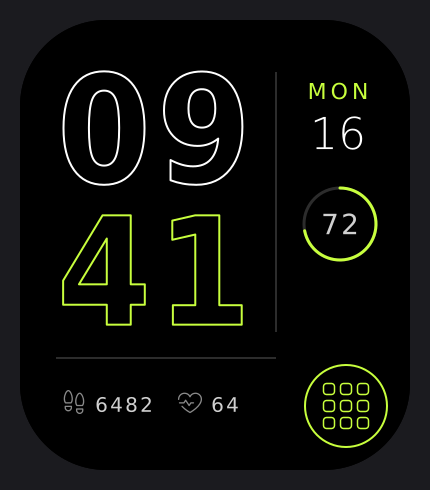
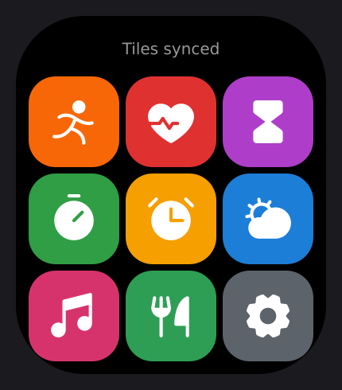
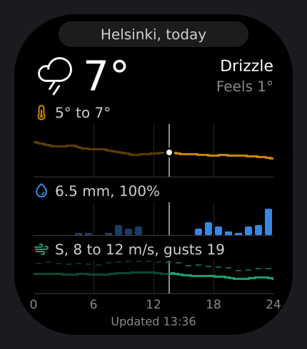
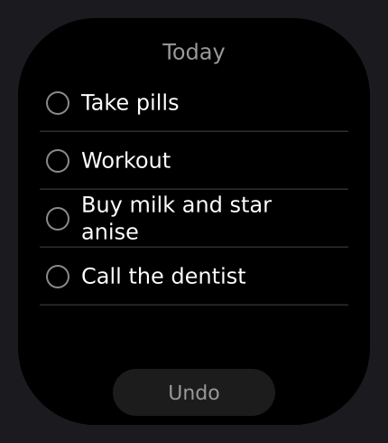

# Zepp OS watch face and apps for the Amazfit Cheetah (Square)

A watch face and four small apps, installed by sideloading through the Zepp app's
Developer Mode.

> **Written by AI.** All of this repository, code, tests and documentation, was written
> by Claude Fable 5.2, an AI model. Keep that in mind before relying on it.

| Launcher Face | Launcher | Nutrition | Weather | Tasks |
| --- | --- | --- | --- | --- |
|  |  |  |  |  |

- **Launcher Face**: time, weekday and date, battery ring, steps and heart rate. The
  button in the bottom right corner opens the Launcher.
- **Launcher**: a grid of app tiles, three to a row, scrolling past nine. The tiles are
  a text list you edit on the phone.
- **Nutrition**: today's calories and protein against a daily goal, with a keypad,
  one-tap presets and undo.
- **Weather**: the day on one screen: conditions now, then temperature, rain or snow,
  and wind hour by hour.
- **Tasks**: today's to-do list. One-off and repeating tasks, added on the phone and
  checked off on the wrist.

## Device

Made for the Amazfit Cheetah (Square): square 390 × 450 display, Zepp OS 3.5 (API level
3.6). The layouts are fixed to that screen. The code may be a useful starting point for
other Zepp OS watches, but nothing is adapted to them.

## Install

You need Node 22.15 or newer, the Zepp app paired with the watch, and a Zepp account.
Run everything from the repo folder.

```sh
npm install
npx zeus login --no-browser   # once
npm run qr:watchface          # builds, then prints a QR code
npm run qr:launcher
npm run qr:nutrition
npm run qr:weather
npm run qr:tasks
```

1. **Developer mode.** In the Zepp app: Profile → Settings → About, tap the Zepp icon
   seven times.
2. **Log in.** `zeus login --no-browser` prints a URL. Open it, sign in, and paste the
   final `http://localhost:…` address from the browser's address bar back into the
   terminal. That page does not load; only its address is needed.
3. **Scan.** Each `npm run qr:…` asks which device to build for, then shows a QR code.
   In the Zepp app: Profile → your watch → Developer Mode → Scan.
4. **Pick the watch face.** Long-press the current watch face and choose Launcher Face.

The Developer Mode page also shows the app logs.

## Launcher tiles

Open the Launcher's settings in the Zepp app and edit the list: one line per tile, three
to a row. The watch picks it up the next time the Launcher opens with the phone nearby,
and keeps its own copy.

```
Workout = workout
Heart rate = hr
Weather = app:68234:page/index @weather
Nutrition = app:68232:page/index @food
Tasks = app:68235:page/index @todo
Torch = screen:FlashLightScreen @torch
sleep
```

| Target | Opens |
| --- | --- |
| `timer` | A built-in app, by name. The label can be left out. |
| `app:68232:page/index` | A mini app, by its app id and entry page. |
| `name:Calculator:page/index` | A mini app, by its English name. |
| `screen:FlashLightScreen` | A built-in screen, by its internal name. |

- Built-in apps have an icon. Other tiles show their label unless you add `@icon`.
- `#rrggbb` at the end of a line colours a text tile.
- Lines starting with `#` are comments. Up to 60 tiles.
- The settings page points out lines it cannot read and skips them.

Built-in app names: `activity`, `hr`, `workout`, `history`, `status`, `weather`, `alarm`,
`timer`, `stopwatch`, `pomodoro`, `worldclock`, `calendar`, `todo`, `music`, `camera`,
`findphone`, `phone`, `settings`, `sleep`, `spo2`, `stress`, `breathe`, `pai`,
`readiness`, `measure`, `cycle`, `body`, `thermometer`, `compass`, `barometer`,
`sunmoon`, `coach`, `voicememo`, `alexa`, `cards`, `membership`.

Icon names are in [`shared/icons.js`](shared/icons.js). To add one, add a line there
naming any [Phosphor icon](https://phosphoricons.com) and a colour, run `npm run icons`,
and reinstall the Launcher.

## Nutrition

**+ kcal** and **+ protein** open a keypad. The buttons below add a preset in one tap.
**Undo last** removes the latest entry of the day.

The daily goals and the presets (one per line, `Label = kcal, protein`, up to six) are
set in the Nutrition settings in the Zepp app.

## Weather

Read left to right, midnight to midnight:

- **Top:** place and day, conditions now, temperature and what it feels like.
- **Temperature:** a line, with the day's low and high.
- **Rain and snow:** a bar per hour, blue for rain and white for snow, with the day's
  total and the highest chance.
- **Wind:** a line for speed, dashes for gusts, and the current direction.
- The vertical line and dot mark now. Past hours are darker.
- Tap the place name for tomorrow, and again to go back.

Set the place in the Weather settings in the Zepp app: type a town or city, and pick
from the list if the first match is the wrong one. Units are on the same page.

The phone fetches the forecast from [Open-Meteo](https://open-meteo.com) each time the
app opens. The watch keeps the last one, so it still works for the rest of the day
without the phone.

## Tasks

The watch shows what is left for today. Tap a task to check it off; **Undo** at the
bottom of the screen brings back the last one. A task you do not get to stays on the
list the next day.

Tasks are added in the Tasks settings in the Zepp app. Tap **Add a task** and type what
to do; end it with a repeat to make it come back:

```
Buy milk and star anise
Take pills every day
Workout every 3 days
Bins every Mon and Thu
Clean the filter every month
```

- A repeat counts from the day the task was done: a workout due every 3 days and done
  a day late is next due 3 days after that.
- `every week`, `every 2 weeks`, `every weekday`, `every year`, `daily` and `weekly` work too.
- The day changes at 4 in the morning, so a late evening still counts.
- The settings page also lists today's tasks with a Done button each, every task with
  the day it is next due, and the one-off tasks already finished. Tap a task there to
  change it.

The tasks are stored on the phone. The watch keeps a copy, so it works with the phone
away and passes on what was checked off the next time the app opens within reach.

## Known issue

Closing a custom app straight back to a watch face can leave the watch face ignoring
taps. Turning the screen off and on fixes it. This is why apps are opened from the
Launcher app and not from tiles on the watch face.

## Development

```sh
npm test          # the real code, run against a mock watch and phone
npm run icons     # regenerate icons and watch face artwork
npm run screens   # redraw the pictures in docs/
npm run build     # build all five into apps/*/dist/
```

```
apps/        watchface, launcher, nutrition, weather, tasks
shared/      tile config parser, tile layout, icon table, settings page look
test/        tests and the mock watch, phone and internet
tools/       icon and picture generators
```

## Licence

[MIT](LICENSE). Icons are from [Phosphor Icons](https://github.com/phosphor-icons/core)
(MIT). The watch face digits use DejaVu Sans. Weather data by
[Open-Meteo](https://open-meteo.com) (CC BY 4.0).

Not affiliated with Zepp or Amazfit.
